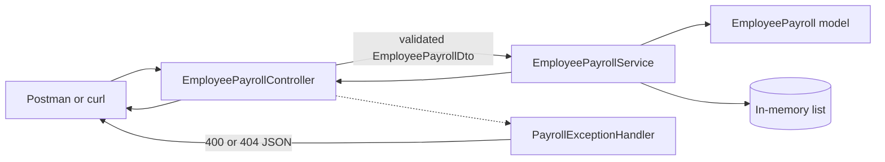
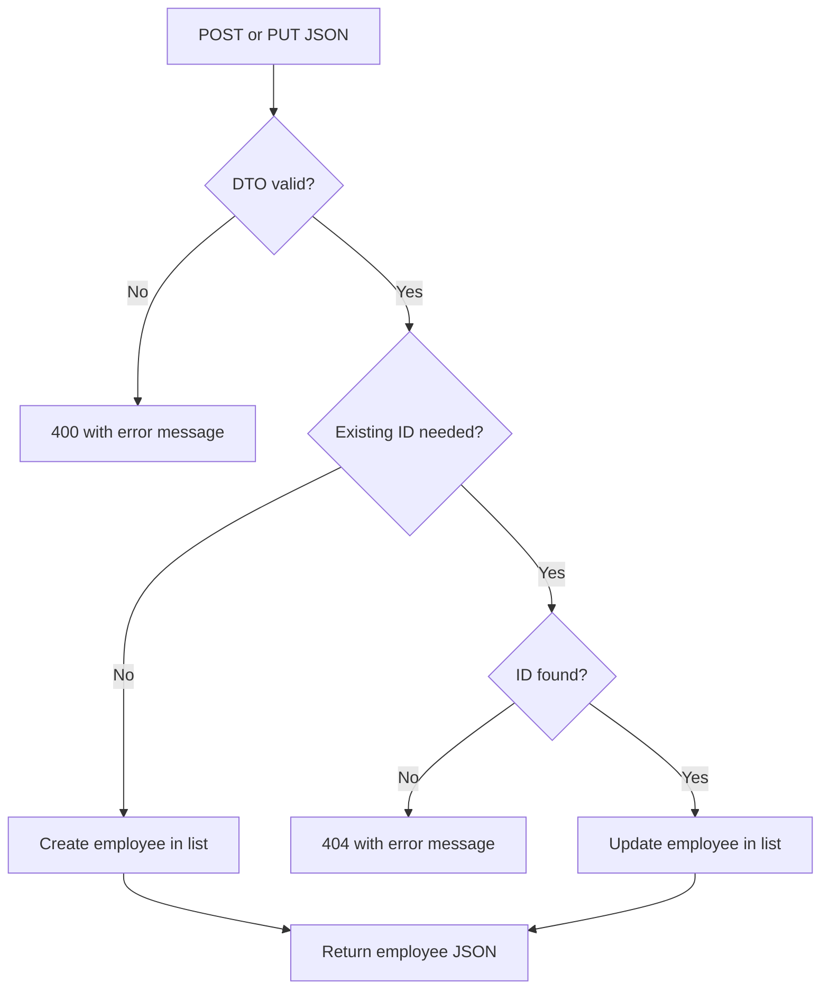

# Employee Payroll System

A simple Spring Boot REST API built through the setup, service, application-settings, validation, and exception-handling sections of the supplied BridgeLabz PDFs. Code lives on [develop](https://github.com/Mihir-Lakhani/Bridgelabz-Employee-Payroll-System/tree/develop); `main` contains this README only.

## Scope and use cases

Each use case was built in a separate `feature/uc-*` branch from `develop` and merged with `--no-ff`. The PDFs restart numbering in each section, so this repository uses one continuous sequence.

| UC | PDF section | Implementation |
| --- | --- | --- |
| 01 | Setup | Spring Boot project and Maven dependencies |
| 02 | REST controller | GET, GET by ID, POST, PUT, and DELETE routes |
| 03 | DTO and model | Separate request DTO and employee model |
| 04 | Service layer | Controller delegates business work to a service |
| 05 | In-memory data | CRUD over a list with generated IDs |
| 06 | Lombok | `@Data` generates DTO accessors |
| 07 | Logging | `@Slf4j` logs create, update, and delete |
| 08 | Profiles | Dev and prod logging properties |
| 09 | Database settings | H2 dev configuration and MySQL prod environment variables |
| 10 | Validation | Validate name and salary on create and update |
| 11 | Validation errors | Friendly HTTP 400 JSON error |
| 12 | Missing ID | Custom exception and HTTP 404 JSON error |

**Current storage:** the service stores employees in an in-memory list. The database settings demonstrate profiles and environment variables; the CRUD code does **not** use JDBC or save employees to MySQL yet. Records disappear on application restart. This matches the supplied sections, which say database persistence comes later.

## Project flow



| Package or file | Purpose |
| --- | --- |
| `controller/EmployeePayrollController` | Maps HTTP methods and paths |
| `dto/EmployeePayrollDto` | Reads JSON and validates name/salary |
| `model/EmployeePayroll` | Employee ID, name, salary |
| `service/EmployeePayrollService` | CRUD, ID assignment, logging |
| `exception/*` | Validation and missing-employee responses |
| `application-*.properties` | Dev/prod logging and database settings |

## Run

Use Java 21 or newer and Maven, or IntelliJ IDEA's Maven tool window.

```bash
git switch develop
mvn spring-boot:run
```

The default `dev` profile starts on `http://localhost:8080` with H2 configuration and no external server. Run tests with `mvn clean test`.

To run with the `prod` profile, start a MySQL server and create a database and user first. Set these environment variables before starting:

| Variable | Meaning | Example |
| --- | --- | --- |
| `MYSQL_HOST` | MySQL host; defaults to localhost | `localhost` |
| `MYSQL_PORT` | MySQL port; defaults to 3306 | `3306` |
| `PAYROLL_DB_NAME` | Database name; defaults to payroll_db | `payroll_db` |
| `PAYROLL_DB_USERNAME` | MySQL username; required | Your DB user |
| `PAYROLL_DB_PASSWORD` | MySQL password; required | Your DB password |

Example PowerShell setup:

```powershell
$env:SPRING_PROFILES_ACTIVE = "prod"
$env:PAYROLL_DB_USERNAME = "your-user"
$env:PAYROLL_DB_PASSWORD = "your-password"
mvn spring-boot:run
```

The prod profile writes logs to `logs/payroll.log`. It establishes a MySQL datasource, but employee CRUD remains in memory.

## REST API

Base path: `/employeepayrollservice`. Employee JSON has `id`, `name`, and `salary`.

| Method | Path | Request body | Success |
| --- | --- | --- | --- |
| GET | `/` | None | `200`, all employees |
| GET | `/get/{id}` | None | `200`, one employee |
| POST | `/create` | Name and salary | `201`, created employee with ID |
| PUT | `/update/{id}` | Name and salary | `200`, updated employee |
| DELETE | `/delete/{id}` | None | `204` |

A missing ID returns `404 {"error":"Employee not found: 1"}`. Invalid create/update input returns `400` with an `error` message.

| Field | Rule |
| --- | --- |
| `name` | Required; starts with a capital letter and has at least three letters |
| `salary` | Integer of at least 500 |

### Try it with curl

```bash
curl http://localhost:8080/employeepayrollservice/
curl -X POST http://localhost:8080/employeepayrollservice/create -H "Content-Type: application/json" -d '{"name":"Lisa","salary":2000}'
curl http://localhost:8080/employeepayrollservice/get/1
curl -X PUT http://localhost:8080/employeepayrollservice/update/1 -H "Content-Type: application/json" -d '{"name":"Mark","salary":3000}'
curl -X DELETE http://localhost:8080/employeepayrollservice/delete/1
```



## Verification and PDF corrections

`mvn clean test` passes two HTTP tests covering CRUD, validation, and missing-ID handling. The duplicated PDF sections were counted once. The PDFs include an outdated MySQL driver class and example hard-coded credentials; this project uses the current MySQL connector and environment variables. Live MySQL connectivity was not part of the automated test because MySQL is optional for the current in-memory CRUD stage.
